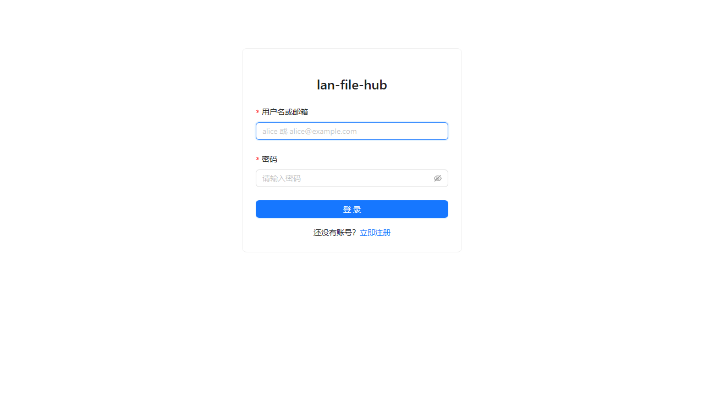
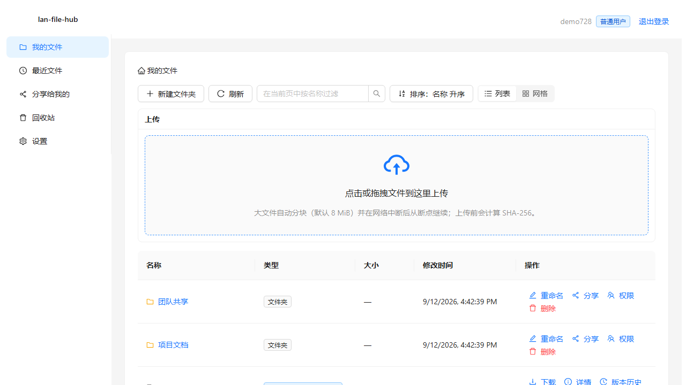
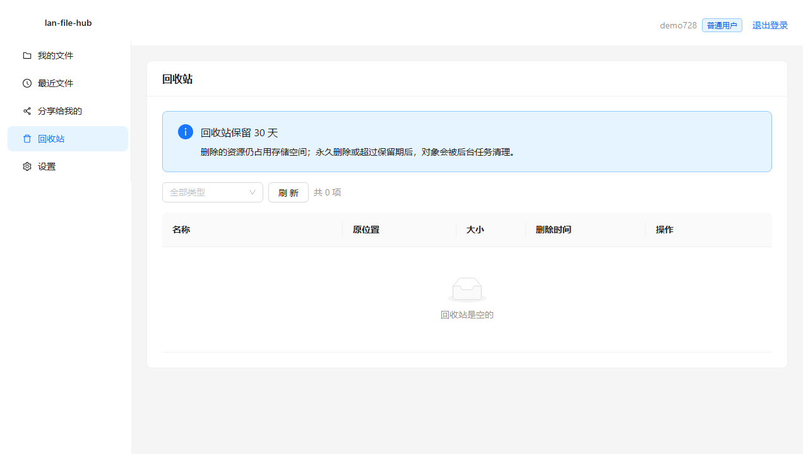
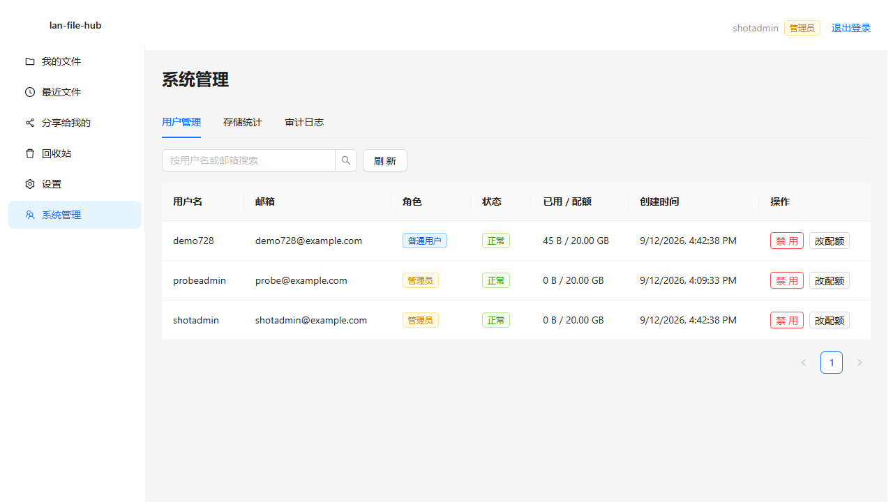
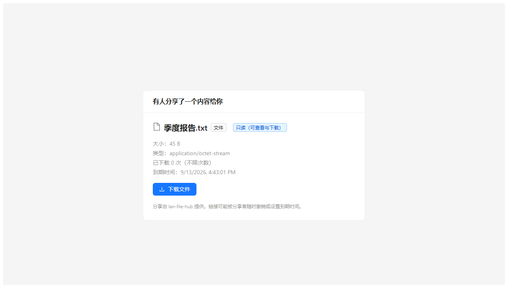
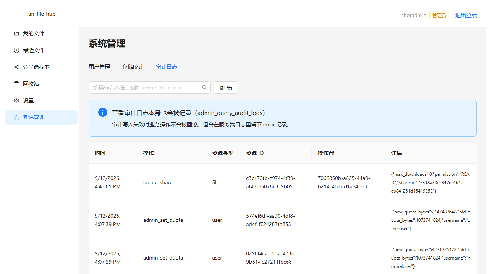
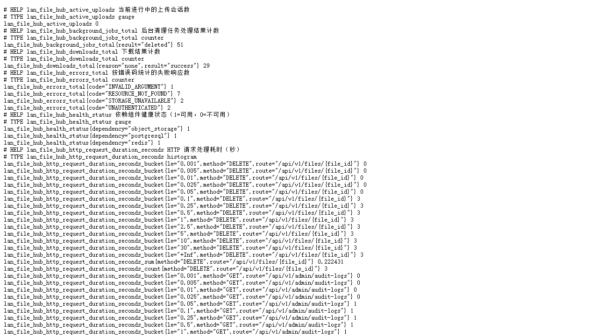

# lan-file-hub

局域网文件同步与团队文件服务：面向个人和中小团队的私有文件管理与局域网共享系统。

> 🟢 **只想快点用起来：看 [`docs/guide.md`](docs/guide.md)（大白话使用说明）** ——
> 怎么启动、手机怎么连、文件怎么发给别人、常见问题，都在那一份里。

> **当前状态：阶段零～十七全部完成（2026-09-12 首发）**，之后按真机试用反馈继续修：
> 一键启动"卡死"根因、菜单"创建管理员"入口、手机局域网访问、以及按用户分享的可用性。
>
> 覆盖能力：
> **后端** 认证、文件夹、上传下载（流式 + Range）、分块续传、去重与配额、文件版本与
> `If-Match` 并发控制、回收站与异步清理、资源权限（READ/WRITE/OWNER + 目录继承）、
> 分享链接（只存 Token 哈希、过期/撤销/次数）、审计日志、
> 限流与安全加固（登录/上传限流、下载限速、请求体上限、CORS 与安全响应头）、
> Prometheus 指标（`/metrics`）与系统管理页（用户管理、存储统计、审计日志查询）。
> **前端** 登录注册、文件管理（列表/网格、排序、搜索、面包屑）、分块上传面板、
> 版本历史、回收站、分享与权限弹窗、分享给我的、公开分享落地页、个人设置。
> **后台** 可停止的清理线程（对象异步删除与重试退避、回收站过期清理、过期上传会话与分块、
> 孤儿临时文件、对象-数据库一致性扫描、存储统计定期校准、启动恢复）。
>
> 项目规划与阶段划分见 [`docs/plan.md`](docs/plan.md) 与 [`docs/phases/`](docs/phases/README.md)；
> 未验证项与遗留见 [`docs/implementation-status.md`](docs/implementation-status.md)。

## 这是什么

一个跑在局域网里的私有文件服务：用户、文件夹、上传下载、断点续传、文件版本、回收站、
分享链接和资源权限。目标不是"又一个网盘"，而是把**大文件传输的可靠性与可恢复性**做扎实，
按工业级标准交付（定位见 [`docs/brief.md`](docs/brief.md)）。

明确不做：多节点自动同步、P2P、桌面同步客户端、S3 兼容、在线编辑、病毒扫描引擎集成。
**本项目与 AI 无关**，不包含任何 AI 能力。

## 界面截图

全部来自**真实运行**（Playwright 打开真实服务截取，脚本见 `frontend/tests/e2e/screenshots.spec.ts`，
重新生成：`$env:PLAYWRIGHT_SHOTS='1'; npx playwright test tests/e2e/screenshots.spec.ts`）。

| 登录 | 我的文件 | 上传 |
|---|---|---|
|  |  |  |

| 回收站 | 系统管理 | 公开分享 |
|---|---|---|
|  |  |  |

审计日志与指标端点：

| 审计日志 | Prometheus 指标 |
|---|---|
|  |  |

## 系统架构

```text
浏览器 (React + TypeScript + Ant Design)
        │  HTTPS（生产由反向代理终止）/ HTTP（内网）
        ▼
Drogon HTTP 层  ── 认证过滤器 · request_id · 安全响应头 · CORS 白名单 · 限流 · /metrics
        │
应用服务层      ── AuthService · FolderService · FileService · UploadService
        │            TrashService · SharingService · AdminService · CleanupService
        ▼
领域层          ── User / Folder / File / FileVersion / UploadSession（纯逻辑，不碰 IO）
        │
        ├── PostgreSQL（元数据、权限、审计、清理队列，事务边界在这里）
        ├── Redis（健康检查与临时状态；不作唯一事实来源）
        └── ObjectStorage 抽象 ── 本地文件系统：objects/<sha[0:2]>/<sha256>（内容寻址）
```

分层规则与并发模型见 [`docs/architecture.md`](docs/architecture.md)。

## 技术栈

| 层 | 选型 |
|---|---|
| 后端 | C++20 + Drogon + libpqxx + hiredis + spdlog + nlohmann/json |
| 数据库 | PostgreSQL 16 |
| 缓存 | Redis 7 |
| 对象存储 | 本地文件系统（经 `ObjectStorage` 抽象） |
| 前端 | React + TypeScript + Vite + Ant Design + TanStack Query（阶段十） |
| 构建 | CMake + CMakePresets + Ninja + vcpkg（manifest 模式） |
| 测试 | GoogleTest、Vitest + Playwright、Google Benchmark |

## 目录结构

```text
lan-file-hub/
├── AGENTS.md                 # 项目规则（每次会话必读）
├── CMakeLists.txt            # 根构建脚本
├── CMakePresets.json         # debug / release / asan 三套预设
├── .clang-format .clang-tidy # 格式与静态检查规则
├── vcpkg.json                # 依赖清单（manifest 模式）
├── Dockerfile                # 后端镜像（多阶段、非 root）
├── docker-compose.yml        # postgres / redis / backend / frontend
├── .env.example              # 环境变量示例 → 复制为 .env
├── backend/
│   ├── include/lan_file_hub/ # 公共头：common / domain / infrastructure / application / api
│   ├── src/                  # 实现：api / application / domain / infrastructure / tools
│   └── tests/                # unit / integration / fixtures
├── frontend/                 # React + TS + Vite + Ant Design（登录/注册/占位主页）
├── migrations/               # 数据库迁移（0001_create_users.sql）
├── scripts/                  # PowerShell 脚本：构建/测试/格式/静态检查
├── docs/                     # 设计文档与阶段任务书
└── .github/workflows/        # backend.yml、docker.yml
```

## 环境要求

| 组件 | 版本 | 说明 |
|---|---|---|
| Visual Studio | 2026（MSVC 14.51） | `D:\VS2026` |
| CMake | ≥ 3.25（本机 3.31.6） | 不在 PATH，见 `scripts/_vsenv.ps1` |
| Ninja | 1.12+ | 已在 PATH |
| vcpkg | 任意近期版本 | 已装在 `D:\Codex Tools\vcpkg`，manifest 模式 |
| Docker Desktop | 任意近期版本 | 用于 PostgreSQL 与 Redis；**本机因 WSL 被禁用暂不可用**，见「已知限制」 |
| Node.js | 20+（本机 24） | 前端阶段才需要 |

> 工具绝对路径集中写在 `scripts/_vsenv.ps1` 里，不要在别处硬编码。
> 注意：`D:\Codex Tools\clang-format\bin\clang-format.exe` 是坏的，用 `D:\Codex Tools\LLVM\bin\clang-format.exe`。

> **网络**：本机直连 GitHub 不稳定（`github.com` 时通时断，vcpkg 报过 `curl error 56`）。
> vcpkg 会自动读取系统代理设置，跑 `vcpkg install` 前请先开启代理软件，否则依赖很可能装到一半失败。
> 已经装好的包会保留，失败后重跑即可续上。

## 快速开始

### 1. 启动依赖服务

```powershell
docker compose up -d postgres redis
```

### 2. 准备配置

```powershell
Copy-Item .env.example .env
```

`.env` 已在 `.gitignore` 中，不会进仓库。默认值对应上面的 compose 服务，
**其中的数据库口令仅限本机开发**；生产环境使用它会被拒绝启动。
开发环境还必须设置 `JWT_SECRET`（长度 ≥ 32），否则无法签发 Token。

### 3. 执行数据库迁移

```powershell
.\build\debug\bin\lan_file_hub_migrate.exe --migrations migrations
```

迁移工具是独立可执行文件，**不会在服务启动时自动跑**（生产环境不应由应用进程改 schema）。
重复执行是安全的：已应用的版本会跳过。

### 4. 构建

```powershell
.\scripts\build.ps1                  # debug
.\scripts\build.ps1 -Preset release
```

首次构建会由 vcpkg 编译 drogon 等依赖，耗时较长；之后走二进制缓存。

### 5. 运行后端

```powershell
.\build\debug\bin\lan_file_hub_server.exe
```

### 6. 运行前端

```powershell
cd frontend
npm install          # 首次
npm run dev          # http://localhost:5173
```

Vite 开发服务器会把 `/api` 与 `/health` 代理到后端（默认 `http://127.0.0.1:8080`），
所以前后端可以分别启动，不需要额外配置跨域。后端端口以 `.env` 的 `HTTP_PORT` 为准：
`scripts/start.ps1` 会把它通过 `LFH_BACKEND_URL` 注入 vite；手动 `npm run dev` 时也可以自己设
`$env:LFH_BACKEND_URL = 'http://127.0.0.1:9080'`。

> ⚠️ **Windows 上 8080 有可能绑不上**：Docker Desktop / Hyper-V / WSL 会预留端口段，
> 8080 常常落在里面（用 `netsh int ipv4 show excludedportrange protocol=tcp` 查看）。
> 这种情况**没有任何进程在监听**，但绑定会失败。后端启动时会自检端口并明确报出原因
> （区分「被占用」与「被系统保留」）后退出，不会带病启动；把 `.env` 的 `HTTP_PORT`
> 换成保留段外的端口即可，脚本与前端代理都会跟着走。

### 7. 验证

```powershell
curl.exe http://127.0.0.1:8080/health/live     # 进程存活，永远不依赖外部组件
curl.exe http://127.0.0.1:8080/health/ready    # 依赖就绪：PostgreSQL / Redis / 对象存储
```

（端口以 `.env` 的 `HTTP_PORT` 为准，改了端口就把上面的 `8080` 一并替换。）

### 8. 创建管理员（要用管理员功能时）

注册页只能注册**普通用户**；第一个管理员必须显式创建（口令只从环境变量读，仓库里不放默认口令）：

```powershell
# 桌面按钮用户：双击 lan-file-hub.cmd → 按 5，按提示输入用户名 / 邮箱 / 口令（口令不回显）
.\scripts\menu.ps1 -Action admin

# 命令行
$env:INITIAL_ADMIN_PASSWORD = '<至少 8 位>'
.\scripts\create-admin.ps1 -Username admin -Email admin@example.com
Remove-Item Env:\INITIAL_ADMIN_PASSWORD

# 容器路径（生产）
docker compose --profile admin run --rm init-admin
```

- 用户名不存在 → 新建 ADMIN 用户；已存在 → **提升为 ADMIN（不改口令）**；已是管理员 → 幂等跳过，
  可以重复执行。
- 登录后管理员功能在左侧「系统管理」（用户管理、系统指标、审计日志）。
- 这是引导口令，登录后请立即修改。

### 9. 手机 / 其它电脑访问（局域网）

前端开发服务器监听所有网卡，**同一网络下的手机或其它电脑**直接打开：

```text
http://<电脑的局域网IP>:5173
```

启动脚本与菜单状态会直接给出这个地址（`📱 手机访问: ...`）。手机只需要访问 5173：
`/api` 与 `/health` 由 vite 代理到电脑本机的后端，不必让手机直连后端端口。

- 电脑连**手机热点**（手机开热点 → 电脑加入）最省事：手机是网关，一定访问得到电脑。
- 校园网 / 公共 WiFi 常开**客户端隔离**，设备之间互相访问会被拦；换热点即可。
- 换网络后 IP 会变，重新看菜单里的地址。
- 界面是桌面版布局，手机能用但排版偏挤（本项目不含移动端适配）。
- 真机测试的完整步骤与排错见 `docs/testing.md`「八、局域网真机测试」。

`/health/ready` 在任一必要依赖不可用时返回 **503**，并在 `components` 里逐项说明原因。

浏览器打开 <http://localhost:5173> 即可注册并登录。

## 大文件分块上传与断点续传

单文件超过 1 MiB 时前端自动走分块上传（默认 8 MiB 一块，可配 1–64 MiB）：

```text
算整文件 SHA-256（流式，内存占用与文件大小无关）
    ↓  创建会话  POST /api/v1/uploads
    ↓  查询已完成分块  GET /api/v1/uploads/{id}
    ↓  并发补传缺失分块（默认 4 路）  PUT .../chunks/{index}  带 X-Chunk-Sha256
    ↓  完成  POST /api/v1/uploads/{id}/complete（服务端重算大小与 SHA-256）
```

可靠性保证：

- **会话与分块状态都在 PostgreSQL**，Redis 不参与断点续传；服务重启后仍能查询到真实的
  已完成分块列表。
- **分块幂等**：同一索引重复上传且内容一致返回成功且不重复写盘；内容不同返回
  `409 CHUNK_CONFLICT`，已存分块不会被覆盖。
- **完成幂等**：重复 `complete` 返回同一个文件记录；并发 `complete` 只有一个请求真正合并。
- **失败不留垃圾**：取消、哈希不匹配、合并失败都会同时清掉数据库分块记录与磁盘分块。
- **前端刷新后恢复**：任务元数据存 IndexedDB，进页面时用 `upload_id` 向后端查询真实状态；
  重新选择同一个文件即只补传缺失分块（浏览器不会替页面保留文件内容）。
- 客户端的整文件 SHA-256 只是提前发现本地读盘错误，**服务端始终自己重算一遍**。

## 权限与分享

**权限级别与继承**（见 [`docs/permissions.md`](docs/permissions.md) §1、§3）：
```text
READ   查看目录、读元数据、下载、查看/下载历史版本
WRITE  包含 READ，并可上传、改版本、移动、重命名、软删除
OWNER  包含 WRITE，并可永久删除、改权限、创建/撤销分享链接
ADMIN  系统级：可访问一切，但访问用户资源必须留审计日志
```

判定顺序：未登录拒绝 → ADMIN 放行（写审计）→ 资源所有者 = OWNER →
资源自身的授权 → **祖先文件夹的授权（取路径上最高一级）** → 都没有则拒绝。

- 文件继承所属文件夹的权限；文件夹继承祖先目录；只统计 ACTIVE 的目录。
- 第一版没有拒绝规则、没有用户组、没有 ACL 优先级（docs/permissions.md 明确排除）。
- 协作者上传的文件**归属目录所有者**，配额记在所有者名下，不会占用协作者的配额。

接口：

```text
GET    /api/v1/resources/{id}/permissions              查看授权列表
PUT    /api/v1/resources/{id}/permissions/{user_id}    授予/修改（幂等）
DELETE /api/v1/resources/{id}/permissions/{user_id}    撤销（幂等）
GET    /api/v1/resources/{id}/effective-permission     我的有效级别（前端用它显示按钮）
```

**分享链接**：

- Token 是 32 字节密码学随机值（base64url，43 字符），服务端**只保存 SHA-256**；
  明文只在创建响应里出现一次，之后无法取回。
- 支持只读/可写、过期时间（最长 365 天）、下载次数上限、撤销（幂等）。
- 公开查看与下载**无需登录**，但服务端完整校验：过期、撤销、次数、
  以及"只能访问它绑定的那一个资源"。
- 下载次数的检查与自增在同一条 SQL 里完成，并发下载不会同时通过。
- 失效原因统一返回 `404`，不告诉调用方是过期、撤销还是超次。
- 目录分享可以查看但**不支持打包下载**（返回 403 并说明原因）。

## 回收站与异步清理

```text
GET    /api/v1/trash                       回收站列表（分页、按类型筛选、显示删除时间）
POST   /api/v1/trash/{id}/restore          恢复（幂等）
DELETE /api/v1/trash/{id}/purge            永久删除
DELETE /api/v1/files/{id}                  软删除文件（进回收站）
```

- **软删除不动磁盘对象**，所以恢复是廉价的；删除的资源仍占配额，永久删除时才回收。
- 删除整个文件夹会把子树里的文件夹**和文件**一起送进回收站，回收站是一份完整清单。
- 恢复的三条规则：重复恢复幂等；原父目录不在则回到用户根目录（响应里说明）；
  同名冲突返回 `409` 并给出冲突对象，不改动任何状态。
- **永久删除不在 HTTP 请求里删磁盘**：事务内删记录并回收配额，把对象 Key 写进
  `cleanup_tasks`，由后台任务异步删除。
- 后台任务每 2 秒轮询：删除前复查**引用计数**（同一对象可能被别的版本引用，计数不为 0 就跳过）；
  失败按 1s→2s→4s 退避重试，超过 5 次置为 `FAILED` 等人工处理，
  **不会因为磁盘删除失败把数据库状态改成"已删除"**。
- 另外默认每 60 秒扫一次回收站，超过保留期（默认 30 天）的条目自动永久删除。
- 删除、恢复、永久删除都会写 `audit_logs`（含操作者、资源、释放的字节数）。

## 去重与存储配额

**物理去重**：对象按内容寻址（`objects/<sha256 前两位>/<sha256>`），相同内容在磁盘上只存一份，
跨用户共享同一个物理对象。

**秒传**：`POST /api/v1/uploads` 带 `sha256` 时，如果**你自己**已经有同样内容与大小的文件，
响应里会给出 `already_exists: true` 与 `existing_file`；客户端可以一个分块都不传，
直接 `complete` 建出新文件记录（不同文件名、同一物理对象）。

- 预检查只回答「你自己有没有这份内容」，不回答「系统里有没有这个哈希」，
  别人的内容查不到，避免上传接口被当成文件存在性探测器。
- 秒传判定用的是服务端数据库里的对象（哈希 + 大小），不是客户端声明。

**配额**：默认每用户 20 GiB（`MAX_USER_STORAGE_BYTES`）。

| 规则 | 取值 |
|---|---|
| 计算口径 | `users.used_storage_bytes` = 该用户所有文件版本大小之和 |
| 相同内容多次引用 | **按逻辑大小重复计算**（同一用户传两份相同内容算两份配额），物理去重只省磁盘 |
| 回收站文件 | 占用空间 |
| 历史版本 | 占用空间 |
| 失败上传的临时分块 | 不占用（失败即清理，从未计入） |

强制方式：创建会话时预检查（用声明大小，只为尽早报错）＋ **提交时在同一事务里锁住用户行再比对**
（`SELECT ... FOR UPDATE`），因此两个并发上传不可能同时通过检查；超限返回 `409 QUOTA_EXCEEDED`，
会话置为 `FAILED` 并清理分块。

**对象删除**：不设独立引用计数器，引用数由 `file_versions` 里引用该哈希的行数推导
（不会有计数漂移）；只有引用数降为 0 时才允许删除物理对象。

## 文件版本

版本**只增不减**，任何历史版本都不会被删除或覆盖：

| 操作 | 接口 | 结果 |
|---|---|---|
| 上传新版本 | `POST /api/v1/uploads` 带 `file_id` + `If-Match` | 版本号 = 当前最大 + 1，`current_version_id` 切到新版本 |
| 查看版本 | `GET /api/v1/files/{id}/versions` | 新版本在前，含版本号、大小、哈希、创建者、时间 |
| 下载历史版本 | `GET /api/v1/files/{id}/versions/{vid}/download` | 支持 Range，响应带 `X-File-Version` |
| 恢复历史版本 | `POST /api/v1/files/{id}/versions/{vid}/restore` | **追加**一个内容等于该版本的新版本，可再次回退 |

**乐观并发控制**：修改文件时带上 `If-Match: <current-version-id>`。
如果期间被别人改过，返回 `409 FILE_VERSION_CONFLICT`，并在 `error.details.current_version_id`
里给出真实当前版本；客户端刷新后重试即可。同一份 `If-Match` 的并发提交只有一个能成功。

其他保证：

- 版本冲突**不会静默覆盖**，也不会留下半成品（落库与配额都在同一个事务里）。
- 恢复**幂等**：当前内容已经等于目标版本时不追加新版本（重复点击不会刷出一堆版本）。
- 配额按版本累计，历史版本占空间；配额不足时加版本被拒，用量不变。
- 内容与当前版本相同的"新版本"上传不会产生重复版本。

## 常用命令


```powershell
.\scripts\build.ps1 -Preset debug      # 配置 + 构建
.\scripts\test.ps1                     # ctest
.\scripts\start.ps1                  # 一键启动：依赖 + 迁移 + 后端 + 前端 + 打开浏览器
.\scripts\stop.ps1                   # 停止后端与前端（-WithDeps 连容器一起停）
.\scripts\migrate.ps1                # 数据库迁移（-InContainer 走容器）
.\scripts\backup.ps1                 # 备份数据库 + 对象存储到 backups\<时间戳>\
.\scripts\restore.ps1 -BackupDir <目录>   # 恢复演练（默认恢复到临时库；-Force 才就地覆盖）
.\scripts\format.ps1                   # clang-format 检查（不改文件）
.\scripts\format.ps1 -Fix              # 就地格式化
.\scripts\lint.ps1                     # clang-tidy（需要先构建过 debug）
```

等价裸命令（脚本只是把 MSVC 环境与工具路径包了一层）：

```powershell
cmake --preset debug
cmake --build --preset debug
ctest --preset debug
```

## 配置

配置来自 `.env` 与进程环境变量，**环境变量优先**。业务代码不直接读环境变量，
全部经 `Config` 模块（`backend/src/common/config.cpp`）。完整清单见 [`.env.example`](.env.example)。

| 变量 | 默认值 | 说明 |
|---|---|---|
| `APP_ENV` | `development` | `production` 会启用额外校验 |
| `HTTP_PORT` | `8080` | |
| `DATABASE_URL` | 本机开发连接串 | 生产环境拒绝使用开发默认口令 |
| `REDIS_URL` | `redis://127.0.0.1:6379/0` | |
| `STORAGE_ROOT` | `./storage` | 启动时规范化为绝对路径 |
| `DEFAULT_CHUNK_SIZE` | `8388608`（8 MiB） | 允许区间 1 MiB ~ 64 MiB |
| `MAX_FILE_SIZE` | `10737418240`（10 GiB） | |
| `MAX_CONCURRENT_UPLOADS` | `16` | 全局同时进行的上传会话数上限 |
| `MAX_CONCURRENT_UPLOADS_PER_USER` | `4` | 单用户上限，不得超过全局上限 |
| `UPLOAD_SESSION_TTL` | `86400`（24 小时） | 上传会话有效期，60 秒 ~ 30 天 |
| `MAX_USER_STORAGE_BYTES` | `21474836480`（20 GiB） | |
| `JWT_SECRET` | 空 | 生产环境必须 ≥ 32 字符 |
| `CORS_ALLOWED_ORIGINS` | `http://localhost:5173` | 逗号分隔，禁止 `*` |

配置错误时服务**启动失败并输出具体原因**，不会带着半套配置跑起来。
本阶段没有任何支持热加载的配置项。

## 认证与 Token 策略

| 项 | 当前做法 |
|---|---|
| 密码存储 | **Argon2id**（m=64 MiB、t=3、p=1，每次随机 16 字节盐），PHC 字符串入库；没有明文，响应里也不含 `password_hash` |
| Token | 短期 **JWT（HS256）单 Token**，有效期由 `JWT_EXPIRE_SECONDS` 控制（默认 3600 秒） |
| Token 传递 | `Authorization: Bearer <token>`，统一由认证过滤器校验 |
| Token 保存（前端） | **内存 + sessionStorage**。**不使用 localStorage** —— 长期存储会放大 XSS 的后果 |
| 失效策略 | 过期返回 `TOKEN_EXPIRED`；用户被禁用后，**即使 Token 未过期也会被拒绝**（过滤器每次复查用户状态）；登出由客户端丢弃 Token 完成 |
| 密钥 | `JWT_SECRET` 只能来自环境变量，不写入源码、日志或仓库 |

> ⚠️ **生产环境应改为 HttpOnly + Secure + SameSite Cookie**（见 [`docs/api.md`](docs/api.md) 认证方案）。
> 当前方案把 Token 暴露给 JavaScript，存在 XSS 窃取风险；这需要后端配合改造，
> 属于后续阶段的工作，**当前状态不得直接用于对公网的生产部署**。

登录失败一律返回同一句「用户名或密码错误」，用户不存在时也会执行一次哈希校验，
避免通过错误文案或响应时间枚举账号；被禁用账号只有在**口令正确**时才会告知「账号已被禁用」。

## 测试

```powershell
.\scripts\test.ps1                     # 后端：单元 + 集成，共 284 个用例
cd frontend; npm test                  # 前端：Vitest，共 111 个用例
```

- **单元测试**：`.env` 解析、配置校验与默认值、request_id、UUID、健康检查与凭据脱敏、
  Argon2id 哈希与校验、JWT 签发/校验/过期/篡改、用户名与邮箱校验、
  分块数量与分块大小校验、上传状态机、分块路径安全。
- **集成测试**：打真实 PostgreSQL，覆盖注册、重复注册、大小写不敏感的唯一性、
  登录（用户名/邮箱/错误口令）、**账号枚举防护**、禁用用户、当前用户查询；
  分块上传全流程：乱序分块、重复分块幂等与冲突、缺失分块、**换新实例后断点续传**、
  哈希不匹配、并发完成只生成一个文件、过期会话、取消幂等、所有者校验、并发上限；
  去重与配额：相同内容物理只存一份、秒传、预检查不泄露他人内容、配额按逻辑大小、
  创建与完成两阶段检查、**两个并发上传不能同时绕过配额**、引用计数降为 0 前不删对象；
  版本与并发：**上传新内容生成新版本、旧对象不被覆盖、历史版本下载、恢复追加新版本、
  重复恢复幂等、过期 If-Match 返回 409 并带当前版本、两人同时改同一文件只有一个成功**、
  版本配额；
  回收站：软删除后列表过滤、恢复幂等、父目录不在时回到根目录、同名冲突 409、
  永久删除回收配额并把对象交给后台任务、引用计数保护、删除失败重试而非静默成功、
  过期回收站清理、审计日志；
  权限与分享：**READ/WRITE/OWNER 权限矩阵、文件夹继承（文件继承目录、路径取最高级）、
  只有所有者能改权限、分享 Token 只存哈希、过期/撤销/下载次数上限、分享只能访问绑定资源、
  目录分享不可下载、管理员访问留审计、永久删除清理悬空授权**。
  数据库不可用时这些用例会**明确跳过**（不会假装通过）；
  设置 `LAN_FILE_HUB_REQUIRE_DB=1` 可让缺失的数据库直接失败（CI 用）。- **前端测试**：Token 存储策略、SHA-256 公开测试向量与流式哈希、分块规划与重试策略、
  上传编排（失败重试、暂停取消、刷新后恢复、去重命中不传分块）。

## 测试环境与限制

性能与故障测试的完整记录见 [`docs/performance.md`](docs/performance.md)。本节只说明**这些数字在什么条件下成立**，避免误读：

| 项 | 条件 |
|---|---|
| 机器 | 12 逻辑核 @ 2096 MHz、Windows 11、E 盘 SSD；MSVC 14.51 + Ninja |
| 网络 | **全部本机回环**：没有真实局域网链路数据，千兆/无线下的表现需要另测 |
| 构建 | 吞吐与延迟数字来自 `release`；正确性测试与故障注入跑在 `debug` |
| 依赖服务 | PostgreSQL 与 Redis 跑在本机 Docker Desktop 里 |
| 数据集 | 固定 LCG 生成的 64 MiB 文件，参数固定，可跨机器/跨提交复现 |

**能测到的**：单实例吞吐（上传/下载）、API P50/P95/P99、并发上传下载、内存是否随文件增长、
依赖不可用时的降级行为、端到端主流程（Playwright 真实浏览器）。

**测不到的（如实列出）**：

- **ThreadSanitizer / UndefinedBehaviorSanitizer 没有运行**：MSVC 不提供这两个 sanitizer，
  而依赖库都是 MSVC 静态库，混用 clang 链接不成立；并发正确性目前由集成测试与代码审查保证。
- 多实例/负载均衡、长稳（数小时）压测、真实磁盘写满场景、真实病毒扫描引擎。
- 上传吞吐的测量值受测试客户端限制（每个分块一个 `curl` 进程）；服务端侧上限见微基准（哈希 2.17 GiB/s、落盘 1.66 GiB/s）。
- 200 次请求的 P99 只有约 2 个样本，只适合看量级，不能当统计结论。

压测脚本：`.\scripts\bench.ps1`（依赖已在跑的后端；任何一项失败都会以非零退出码结束）。
微基准：`build\release\bin\lan_file_hub_benchmarks.exe`。
## 已知限制

- 业务功能覆盖到权限与分享：认证、文件夹、上传下载、分块续传、去重配额、版本、回收站、
  资源权限与分享链接已可用；**完整前端界面尚未完成**（阶段十收口）。
- **前端上传的进度以分块粒度为准**：进度条按「已完成分块字节 + 正在传输字节」估算，
  单个分块内部的上报频率取决于浏览器，不做平滑插值。
- **刷新后恢复上传需要重新选择文件**：浏览器不允许页面在刷新后继续持有 `File`
  内容（除非用 File System Access API）。任务列表、`upload_id` 与已完成分块会从后端恢复，
  重新选中同名同大小的文件后只补传缺失分块。
- **上传有两条路径**：请求体 ≤ 1 MiB 时由 Drogon 缓冲后一次性写入，超过则走
  `RequestStream` 流式写入。两条路径都**不会把整个文件读进内存**。
- **前端下载会把文件读进浏览器内存**：接口需要 `Authorization` 头，暂时只能用
  blob 方式下载。大文件流式下载与「改用 HttpOnly Cookie」一起在后续阶段处理。
- **前端缺分页控件**：列表只显示第一页（总数会提示），拖拽移动与分页在阶段十。
- **管理员账号需要显式创建**：注册页只创建普通用户，第一个管理员用 `.\scripts\create-admin.ps1`
  （或桌面菜单按 5）创建——用户名已存在时是**提升为 ADMIN**，不改口令。方式见「快速开始 8」。
- **Token 放在 sessionStorage**：生产部署前必须改为 HttpOnly Cookie，见上文「认证与 Token 策略」。
- **下载限速默认关闭**：`DOWNLOAD_RATE_LIMIT=0` 表示不限速（局域网场景按带宽优先）。开启后按用户做字节级令牌桶限速，
  代价是该路径改为 chunked 传输、没有 `Content-Length`（Range 仍可用）；细节见 `docs/storage.md`「下载限速」。
- **镜像构建耗时**：后端镜像要在 Linux 容器里从源码编译整套 C++ 依赖（Drogon/OpenSSL/libpqxx…），首次构建很久（本机实测约 40 分钟）；
  `.dockerignore` 已排除本地 `build/`、`vcpkg_installed/` 与 `node_modules/`，避免把数 GB 上下文送进 daemon。
  `postgres` 与 `redis` 两个服务已验证可用（`Up (healthy)`，5432 / 6379 已映射）。
  开发时用 `docker compose up -d postgres redis` 起依赖，或用 `D:\Codex Tools\Redis\redis-server.exe`。
- **clang-tidy 需要兼容开关**：本机 clang-tidy 是 19.1.0，而 VS2026 的 STL 要求 Clang 20+，
  `scripts/lint.ps1` 里已带上 `-D_ALLOW_COMPILER_AND_STL_VERSION_MISMATCH`；
  长期方案是升级 LLVM。clang-format 与 clang-tidy 都取自 `D:\Codex Tools\LLVM\bin`。
- **没有病毒扫描**：本期只有 `FileScanner` 接口与 `NoopFileScanner`（明确返回"未扫描"，不假装扫过）。
  上传完成路径已经接上这个钩子，但**上传的文件不会被查毒**；接入真实引擎前不要把它当作安全边界。
- **UBSan / TSan 未配置**：MSVC 只支持 AddressSanitizer；UBSan 与 TSan 需要 clang/gcc，
  计划随 CI 或 Linux 构建补齐（见 [`docs/testing.md`](docs/testing.md)）。
- **`release` 与 `asan` 预设未运行**：阶段一验收只覆盖 debug；两者留待阶段十四统一验证。
- **配置不支持热加载**：任何配置改动都需要重启进程。
- **路径按 ANSI 窄字符处理**：存储根目录请使用 ASCII 路径。
- **CI 从未运行**：尚未创建 GitHub 远程仓库。

## 文档

| 文档 | 内容 |
|---|---|
| [`docs/brief.md`](docs/brief.md) | 项目定位、目标用户、范围、里程碑 |
| [`docs/architecture.md`](docs/architecture.md) | 系统组成、分层约束、并发模型、可观测性 |
| [`docs/data-model.md`](docs/data-model.md) | 表结构、状态枚举、事务边界 |
| [`docs/api.md`](docs/api.md) | 端点、错误码、分页、认证 |
| [`docs/storage.md`](docs/storage.md) | 对象存储、路径安全、分块协议、去重 |
| [`docs/permissions.md`](docs/permissions.md) | 权限模型与分享链接 |
| [`docs/security.md`](docs/security.md) | 安全要求与必测攻击场景 |
| [`docs/recovery.md`](docs/recovery.md) | 故障处置、后台任务、备份恢复 |
| [`docs/final-review.md`](docs/final-review.md) | 最终审查与验收报告（阶段十七：30 项逐条结论与分级问题） |
| [`docs/release-checklist.md`](docs/release-checklist.md) | 发布检查清单（构建/测试/部署/安全/文档/产物） |
| [`docs/frontend.md`](docs/frontend.md) | 页面、状态机、上传算法 |
| [`docs/testing.md`](docs/testing.md) | 测试清单与验收标准 |
| [`docs/deployment.md`](docs/deployment.md) | 配置、容器、部署、发布 |
| [`docs/implementation-status.md`](docs/implementation-status.md) | 实施状态与审计结论 |
| [`docs/phases/`](docs/phases/README.md) | 18 个阶段任务书与 MVP 冻结边界 |
| [`AGENTS.md`](AGENTS.md) | 项目规则、红线、命令 |

## 路线图

阶段零～十构成可发布的 MVP（认证 → 文件夹 → 上传下载 → 分块续传 → 去重配额 → 版本 →
回收站 → 权限分享 → 前端）；阶段十一～十七是可靠性、安全、可观测性、性能测试、部署与发布验收。
按工业级标准交付，**这七项是发布前必做，不是可选项**。

## 许可证

尚未确定。在确定之前不会创建 `LICENSE` 文件。
